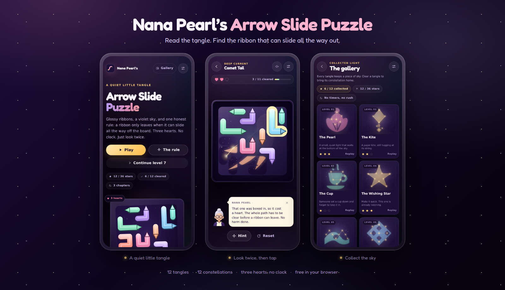

<p align="center">
  
</p>

<h1 align="center">Nana Pearl’s Arrow Slide Puzzle</h1>

<p align="center">
  <strong>Read the tangle. Find the ribbon that can slide all the way out.</strong><br />
  Three hearts. Twelve tangles. Twelve constellations. No clock.
</p>

<p align="center">
  <a href="https://gerrcass.github.io/arrow-slide-puzzle/"></a>
  
  
</p>



## Play

**[gerrcass.github.io/arrow-slide-puzzle](https://gerrcass.github.io/arrow-slide-puzzle/)** — free in the browser, installable, and playable offline after the first visit.

## The rule

Tap a ribbon when its whole path is clear. It slides off the board. If any part of the ribbon would clip another ribbon on the way out, it bumps instead and costs one heart.

That is the entire ruleset. The puzzle is in the looking: a long, bent ribbon can look free at its tip and still be boxed in three cells later. Clearing a ribbon peels back the frost and exposes a constellation. Clear the tangle and the whole sky is yours.

- **Three hearts per attempt.** A bump costs one. You can retry instantly.
- **Three stars for a flawless clear.** Stars are the hearts you kept, and your best result is saved.
- **Free hints.** A hint pulses a ribbon that is genuinely clear. It never costs a life or a star.
- **No clock, ads, accounts, or energy.** Close the tab and come back later.

## What is inside

- **12 curated tangles** in three chapters, from gentle 6×6 boards to dense 8×8 knots.
- **12 original constellations**, revealed progressively as ribbons leave and collected in the gallery.
- **Nana Pearl**, an original guide who teaches the rule in three beats and appears only when she has something useful to say.
- **Synthesised sound**, a mute control, reduced motion, and keyboard play.
- **A local-first save** for stars, unlocks, constellations, and settings.
- **An offline PWA** with a hand-written service worker and no runtime framework.
- **Solver-verified content**: every shipped level is proven clearable by the in-repo solver on every test run.

## Controls

| Action | Pointer | Keyboard |
| --- | --- | --- |
| Slide a ribbon | Click / tap | Tab to the ribbon, then Enter or Space |
| Hint | Hint button | `H` |
| Reset attempt | Reset button | `R` |
| Settings / close | Header button | `Esc` |
| Move between controls | — | `Tab` / `Shift+Tab` |

## Accessibility

The game is visual by nature, so accessibility is designed in rather than claimed:

- Every ribbon is a focusable button named by colour, length, and heading.
- An optional **assistive mode** adds *clear* / *blocked* state to each name and exposes a **Describe clear ribbons** action for screen-reader play.
- Live regions announce clears, collisions, hearts, hints, wins, and gallery unlocks.
- Dialogs trap and restore focus; the skip link goes straight to the board.
- `prefers-reduced-motion` is honoured, with an in-app override.
- Colour is never the only signal, text meets WCAG AA, and every button control is at least 44 × 44 px. Ribbon hit areas cover the whole ribbon plus a one-cell halo: **50 / 44 / 39 px** on 6×6 / 7×7 / 8×8 at 390 px, and **34 / 30 / 26 px** at 320 px. All clear the WCAG 2.2 AA 24 px minimum; the densest boards also offer the full ribbon length, keyboard play, and assistive mode. Measurements and the deliberate halo cap live in [`docs/accessibility.md`](docs/accessibility.md).

## Development

```sh
npm install
npm run dev             # Vite dev server
npm run typecheck       # strict TypeScript
npm run test            # engine, solver, content, progress, guide, reveal
npm run test:e2e        # Playwright + axe against the production build
npm run build           # production build
npm run preview         # serve the production build
npm run check           # typecheck + unit tests + build
npm run verify          # check + Playwright/axe in one command
npm run levels:generate # regenerate the twelve committed levels
npm run assets:generate # regenerate icons and the social card
```

The browser tests need Chromium. On Linux the config uses `/usr/bin/chromium-browser` when present; on CI, Playwright installs its own.

## Architecture

```text
src/
├── engine/        pure rules: geometry, clearance, attempt state, solver, metrics
├── generator/     seeded reverse-construction level generator (offline tool)
├── content/       committed levels, constellations, chapter bands, validation
├── app/           hash router, screens, SVG renderer, guide, audio, progress
└── styles/        tokens, base, board, play, levels, dialogs
```

Two decisions are load-bearing:

- **Rigid translation with full-exit clearance** (`docs/adr/0001`). A bent ribbon translates as one body and must survive every intermediate offset.
- **Removal is monotonic** (`docs/adr/0002`). Removing a ribbon only frees space, so there are no dead ends and any clear ribbon is safe to remove. Difficulty lives in perception, not in a hidden order.

The rules engine has no DOM, storage, clock, or randomness. The renderer animates its output. Read [`GLOSSARY.md`](GLOSSARY.md) for the shared vocabulary and [`docs/adr/`](docs/adr/) for the rest of the decisions.

## Deployment

`main` is deployed to GitHub Pages by [`.github/workflows/pages.yml`](.github/workflows/pages.yml). Every push and pull request is checked by [`.github/workflows/verify.yml`](.github/workflows/verify.yml): typecheck, unit and solver tests, production build, and the Playwright/axe suite.

The site uses relative asset paths and hash routing, so it works from the `/arrow-slide-puzzle/` project subpath with no server rewrites. A small service worker precaches the shell and hashed assets; the offline path is covered by an end-to-end test.

Local production Lighthouse (mobile): **100 performance, 100 accessibility, 100 best practices, 100 SEO**, LCP 1.1 s, CLS 0, re-run after the final layout pass. See [`docs/evidence/lighthouse.md`](docs/evidence/lighthouse.md).

## Credits

Design, code, levels, constellation art, Nana Pearl, and copy are original to this project. The display typeface is [Fredoka](https://github.com/hafontia/fredoka-one) under the SIL Open Font License; its licence is committed at [`public/fonts/OFL.txt`](public/fonts/OFL.txt).

The mechanics are inspired by the arrow-slide puzzle family. No art, audio, copy, or characters from any commercial release are used.

Licensed under the [MIT License](LICENSE).
